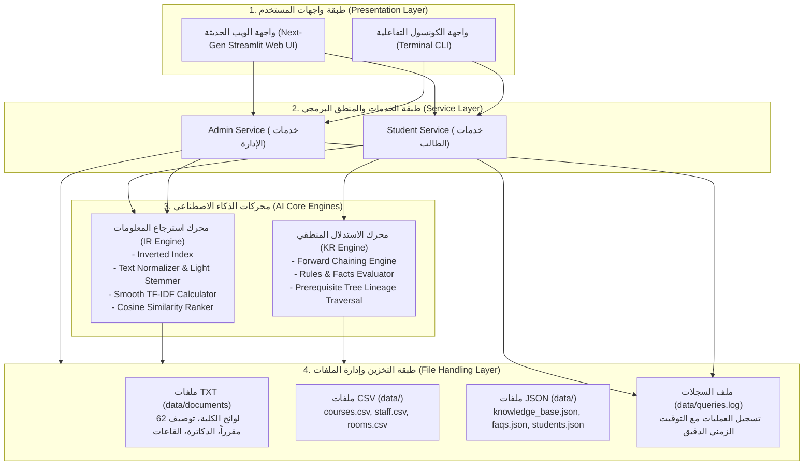

# 🎓 التقرير الفني والأكاديمي الشامل
## مشروع دليل الطالب الذكي (Task 1: Smart Student Guide)
### مقرر الذكاء الاصطناعي — كلية الذكاء الاصطناعي (جامعة كفر الشيخ)
**العام الجامعي:** 2026 م

---

## فهرس محتويات التقرير

1. **المعلومات الأساسية والبيانات العامة للمشروع**
2. **المقدمة وأهداف النظام الأكاديمي**
3. **تحليل لائحة الكلية وقواعد المعرفة (Bylaws Analysis)**
4. **المعمارية الهندسية للنظام (System Architecture)**
5. **محرك استرجاع المعلومات (Information Retrieval Engine)**
   * المعالجة المسبقة للنصوص العربية والإنجليزية
   * خوارزمية الفهرس المعكوس (Inverted Index)
   * الأساس الرياضي لحساب أوزان $TF \times IDF$
   * قياس التشابه الزاوي وترتيب النتائج (Cosine Similarity)
6. **تمثيل المعرفة ومحرك الاستدلال (Knowledge Representation & Inference)**
   * نمذجة الحقائق والقواعد (Facts & Horn Clauses)
   * خوارزمية التعاقب الأمامي (Forward Chaining)
   * قواعد فحص الأهلية وشروط التسجيل والإنذار الأكاديمي
   * تتبع مسار المتطلبات التراكمية (Prerequisite Lineage Tree)
7. **إدارة الملفات وتوثيق السجلات (File Handling & Logging)**
   * تكامل ملفات TXT و CSV و JSON
   * آلية تسجيل الاستعلامات في `queries.log`
8. **تصميم واجهات المستخدم (User Interfaces & UX Design)**
   * واجهة الطرفية التفاعلية (CLI)
   * واجهة الويب المتطورة (Next-Gen Dark Tech Streamlit UI)
9. **نتائج التشغيل التجريبي وحالات الاختبار (Sample Runs & Verification)**
10. **الخاتمة والتوصيات المستقبلية**

---

## 1. المعلومات الأساسية والبيانات العامة للمشروع

| البند | البيان التفصيلي |
| :--- | :--- |
| **اسم المشروع / التاسك** | Task 1: Smart Student Guide (دليل الطالب الأكاديمي الذكي) |
| **المقرر الدراسي** | مقرر الذكاء الاصطناعي (Artificial Intelligence Course) |
| **الجهة المستهدفة** | كلية الذكاء الاصطناعي – جامعة كفر الشيخ |
| **اللائحة المعتمدة** | لائحة مرحلة البكالوريوس بنظام الساعات المعتمدة (برنامج الذكاء الاصطناعي 2023) |
| **لغات وتقنيات التطوير** | Python 3.14, Streamlit, JSON, CSV, Regex |

---

## 2. المقدمة وأهداف النظام الأكاديمي

تعتمد الدراسة في كلية الذكاء الاصطناعي بجامعة كفر الشيخ على **نظام الساعات المعتمدة**، وهو نظام مرن يتطلب من الطالب اتخاذ قرارات أكاديمية دقيقة في كل فصل دراسي بخصوص المقررات المؤهل لتسجيلها، العبء الدراسي المسموح به، وشروط المتطلبات السابقة وتفادي الإنذارات الأكاديمية.

### الأهداف الرئيسية التي تم تحقيقها:
1. **استرجاع المعلومات الأكاديمية اللحظي (Information Retrieval):** تمكين الطالب والباحث من البحث باللغتين العربية والإنجليزية في كامل نصوص لوائح الكلية، توصيف المقررات الـ 62، بيانات أعضاء هيئة التدريس وساعاتهم المكتبية، وأماكن القاعات والمعامل التخصصية.
2. **الاستدلال الأكاديمي الآلي (Automated Academic Inference):** الإجابة البرمجية الذكية على السؤال المحوري لكل طالب:  
   > *"ما هي المقررات التي يحق لي تسجيلها في الفصل القادم؟"*  
   > *(Which courses am I eligible to register for?)*  
   وذلك عبر فحص المقررات المجتازة بنجاح، وشجرة المتطلبات السابقة، وحساب الحدين الأدنى والأقصى لساعات التسجيل حسب المعدل التراكمي (CGPA).
3. **تتبع مسار المقررات المتسلسلة (Prerequisite Lineage):** إظهار شجرة العلاقات التراكمية للمقررات المتقدمة لتسهيل التخطيط الفصلي.
4. **التكامل الشامل للملفات وتوثيق السجلات:** قراءة وتعديل البيانات عبر ملفات TXT و CSV و JSON، مع توثيق كافة استعلامات الطلاب في ملف سجل زمني (`queries.log`).

---

## 3. تحليل لائحة الكلية وقواعد المعرفة (Bylaws Analysis)

تم استخراج كافة القواعد المنطقية والأكاديمية من اللائحة الرسمية المعتمدة (برنامج عام 2023) وتضمينها في النظام كالتالي:

1. **متطلبات التخرج الأساسية (المادة 5):**
   * اجتياز **144 ساعة معتمدة** بنجاح.
   * ألا يقل المعدل التراكمي العام للتخرج (CGPA) عن **2.00 من 4.00**.
2. **المستويات الدراسية (المادة 16):**
   * **المستوى الأول (Level 1):** أقل من 30 ساعة معتمدة.
   * **المستوى الثاني (Level 2):** من 30 إلى أقل من 65 ساعة معتمدة.
   * **المستوى الثالث (Level 3):** من 65 إلى أقل من 100 ساعة معتمدة.
   * **المستوى الرابع (Level 4):** 100 ساعة معتمدة فأكثر.
3. **العبء الدراسي المسموح به للتسجيل (المادة 8):**
   * الحد الأدنى للتسجيل في الفصول النظامية: **9 ساعات معتمدة**.
   * الحد الأقصى للمستجدين في الفصل الأول: **18 ساعة معتمدة**.
   * إذا كان $\text{CGPA} \ge 3.00$ أو في فصل التخرج: يسمح بتسجيل حتى **21 ساعة معتمدة**.
   * إذا كان $2.00 \le \text{CGPA} < 3.00$: الحد الأقصى **18 ساعة معتمدة**.
   * إذا كان $1.00 \le \text{CGPA} < 2.00$: يقيد التسجيل بـ **15 ساعة معتمدة** لمساعدة الطالب على رفع معدله.
   * إذا كان $\text{CGPA} < 1.00$: يقيد بـ **12 ساعة معتمدة** فقط.
   * الفصل الصيفي (اختياري): الحد الأقصى **9 ساعات معتمدة**.
4. **الإنذار والملاحظة الأكاديمية (المادة 22):**
   * يوضع الطالب تحت الملاحظة ويوجه له إنذار أكاديمي إذا قل الـ CGPA عن **2.00** في أي فصل دراسي نظامي (باستثناء الفصل الأول للمستجد).
   * يفصل الطالب إذا حصل على 4 إنذارات متتالية أو 6 إنذارات متفرقة.
5. **مشروع التخرج والتدريب الصيفي (المادتان 14 و 19):**
   * **مشروع التخرج (GP411):** يشترط اجتياز **100 ساعة معتمدة** على الأقل (6 ساعات على فصلين متتاليين).
   * **التدريب الصيفي الميداني:** إجباري (4 ساعات معتمدة لمدة شهر)، ويشترط اجتياز 50% من ساعات التخرج (**72 ساعة معتمدة**).
6. **شروط مرتبة الشرف (المادة 17):**
   * ألا يقل المعدل التراكمي عن 3.00 في أي مستوى دراسي، إنهاء الدراسة في 4 سنوات، وعدم الرسوب في أي مقرر.

---

## 4. المعمارية الهندسية للنظام (System Architecture)

---

## 5. محرك استرجاع المعلومات (Information Retrieval Engine)

تم بناء محرك استرجاع المعلومات بالكامل من الصفر (From Scratch) في ملف `src/ir_engine.py` دون الاعتماد على مكتبات جاهزة (مثل Lucene أو Scikit-Learn)، لضمان تلبية الشروط الأكاديمية بنسبة 100%.

### 5.1 المعالجة المسبقة للنصوص (Text Preprocessing & Normalization)
1. **معالجة الحروف العربية:**
   * إزالة التشكيل (الفَتْح، الضَّم، الكَسْر، السُّكُون، التنوين).
   * إزالة التطويل والكشيدة (`ـ`).
   * توحيد أشكال الألف (`أ`، `إ`، `آ` $\rightarrow$ `ا`).
   * توحيد التاء المربوطة (`ة` $\rightarrow$ `ه`) والألف المقصورة (`ى` $\rightarrow$ `ي`).
2. **استبعاد كلمات التوقف (Stopword Filtering):**
   * تنقية أكثر من 60 كلمة توقف عربية شائعة (في، من، على، الذي، التي، هذا، هو، مع...).
   * تنقية كلمات التوقف الإنجليزية (the, a, is, are, in, of, to, with...).
3. **الجذع اللغوي الخفيف (Light Stemming):**
   * إزالة السوابق: التعريف (`ال`)، حروف العطف والجر الملتصقة (`كال`، `بال`، `فال`، `وال`).
   * إزالة اللواحق: الجمع والمؤنث والتملك (`ات`، `ون`، `ين`، `هم`، `ها`، `نا`).

### 5.2 خوارزمية الفهرس المعكوس (Inverted Index)
يقوم الفهرس المعكوس برسم خرائط للكلمات المفتاحية إلى قائمة الوثائق أو المقاطع التي وردت فيها مع تكرار كل مصطلح:
$$\text{Index}(t) = \{ d_i : f_{t, d_i} \}$$
* يتم تقسيم الملفات النصية الكبيرة تلقائياً إلى مقاطع دلالية (Passages) بحسب المواد الأكاديمية (`مادة X`) أو أكواد المقررات (`[ML211]`) أو القاعات لضمان دقة الاسترجاع.
* يبلغ إجمالي المقاطع المفهرسة حالياً **58 مقطعاً دلالياً** تضم أكثر من **1230 مصطلحاً مفهرساً فريداً**.

### 5.3 الأساس الرياضي لحساب أوزان $TF \times IDF$
* **تكرار المصطلح النسبي (Normalized Term Frequency):**
  $$TF(t, d) = \frac{f_{t, d}}{\sum_{t' \in d} f_{t', d}}$$
* **معكوس تكرار الوثيقة المنعم (Smooth Inverse Document Frequency):**
  $$IDF(t) = \ln\left( \frac{N + 1}{DF(t) + 1} \right) + 1$$
  حيث $N$ هو إجمالي عدد الوثائق في الفهرس، و $DF(t)$ هو عدد الوثائق التي ورد فيها المصطلح $t$.
* **وزن المصطلح في الوثيقة:**
  $$w(t, d) = TF(t, d) \times IDF(t)$$

### 5.4 قياس التشابه وترتيب النتائج (Cosine Similarity)
لقياس الزاوية بين متجه استعلام الطالب $\vec{q}$ ومتجه الوثيقة $\vec{d}$:
$$\text{Cosine Similarity}(q, d) = \frac{\vec{q} \cdot \vec{d}}{\|\vec{q}\| \|\vec{d}\|} = \frac{\sum_{t \in q \cap d} w(t, q) \cdot w(t, d)}{\sqrt{\sum_{t \in q} w(t, q)^2} \cdot \sqrt{\sum_{t \in d} w(t, d)^2}}$$
* ترتب النتائج تنازلياً حسب قيمة التطابق ($0.0 \rightarrow 1.0$).
* يتم استخلاص مقتطف سياقي (Snippet Extraction) بطول 250 حرفاً حول الكلمة المفتاحية لإبراز مكان التطابق للطالب فوراً.

---

## 6. تمثيل المعرفة ومحرك الاستدلال (Knowledge Representation & Inference)

تم بناء محرك الاستدلال المنطقي في ملف `src/knowledge_base.py` استناداً إلى المنطق الصوري (First-Order Logic & Horn Clauses).

### 6.1 نمذجة الحقائق والقواعد (Facts & Rules)
* **الحقائق الأساسية (Facts):**
  * توصيف الـ 62 مقرراً، عدد ساعاتها، وتصنيفها (Core / Elective).
  * شبكة المتطلبات السابقة لكل مقرر: `Prerequisite(Course, PrereqCourse)`.
* **قواعد الاستدلال (Inference Rules):**
  1. **قاعدة الأهلية العامة:**
     $$\text{Eligible}(S, C) \iff \neg \text{Passed}(S, C) \land \forall P \in \text{Prerequisites}(C): \text{Passed}(S, P) \land \text{CheckSpecial}(S, C)$$
  2. **قاعدة مشروع التخرج:**
     $$\text{PassedHours}(S) \ge 100 \implies \text{Eligible}(S, \text{GP411})$$
  3. **قاعدة التدريب الصيفي الميداني:**
     $$\text{PassedHours}(S) \ge 72 \implies \text{Eligible}(S, \text{FIELD\_TRAINING})$$
  4. **قاعدة عبء الساعات المسموح به (Credit Hour Caps):**
     $$\text{CGPA}(S) \ge 3.00 \implies \text{MaxHours}(S) = 21$$
     $$2.00 \le \text{CGPA}(S) < 3.00 \implies \text{MaxHours}(S) = 18$$
     $$1.00 \le \text{CGPA}(S) < 2.00 \implies \text{MaxHours}(S) = 15 \quad (\text{Academic Probation})$$
     $$\text{CGPA}(S) < 1.00 \implies \text{MaxHours}(S) = 12 \quad (\text{Critical Probation})$$

### 6.2 خوارزمية التعاقب الأمامي (Forward Chaining)
عند استعلام الطالب *"Which courses am I eligible to register for?"*:
1. يقوم المحرك بحساب إجمالي الساعات المجتازة ومطابقتها مع المستوى الدراسي (Level 1 to 4).
2. فحص حالة الطالب الأكاديمية (Good Standing أو Academic Probation) وإصدار التنبيهات الرسمية.
3. حساب الحد الأدنى والأقصى لساعات التسجيل للفصل القادم.
4. إجراء مسح شامل لجميع مقررات اللائحة وتصنيفها إلى:
   * **مقررات متاحة للتسجيل (Eligible):** استوفت جميع متطلباتها وتظهر بكامل تفاصيلها.
   * **مقررات مقفلة (Locked):** مع بيان أسماء المتطلبات السابقة المتبقية بالتحديد.
   * **مقررات تم اجتيازها مسبقاً (Completed).**

### 6.3 شجرة تتبع المتطلبات التراكمية (Prerequisite Lineage Tree)
باستخدام خوارزمية البحث في العمق (Depth-First Search - DFS)، يقوم النظام بتتبع مسار المواد التراكمي العكسي لأي مقرر متقدم.  
**مثال لمقرر `[ML411]` تصميم الأنظمة للذكاء الاصطناعي:**
$$\text{BC111 (Structured Prog)} \rightarrow \text{BC211 (OOP)} \rightarrow \text{BC223 (Data Structures)} \rightarrow \text{BC312 (Algorithms)} \rightarrow \text{ML411}$$

---

## 7. إدارة الملفات وتوثيق السجلات (File Handling & Logging)

تتحكم فئة `FileManager` في ملف `src/file_manager.py` بالعمليات المركزية لقراءة وتحديث البيانات:
1. **ملفات TXT (`data/documents/`):** تخزين نصوص اللائحة، وتوصيف المقررات، وأعضاء هيئة التدريس، والقاعات والمعامل.
2. **ملفات CSV (`data/`):**
   * `courses.csv`: يحتوي على 62 مقرراً بكامل بياناتها وساعاتها وأقسامها.
   * `staff.csv`: بيانات أعضاء هيئة التدريس ورتبهم ومكاتبهم وساعاتهم المكتبية.
   * `rooms.csv`: بيانات المدرجات والمعامل وسعتها وتجهيزاتها التقنية.
3. **ملفات JSON (`data/`):**
   * `knowledge_base.json`: حقائق وقواعد اللائحة والمتطلبات السابقة.
   * `faqs.json`: بنك الأسئلة الشائعة وإجاباتها الرسمية.
   * `students.json`: سجل ملفات الطلاب وحالتهم الأكاديمية.
4. **ملف السجلات (`data/queries.log`):**
   * توثيق كل استعلام أو عملية بحث أو استدلال أو إجراء إداري مع طابع زمني دقيق بصيغة قياسية.

---

## 8. تصميم واجهات المستخدم (User Interfaces & UX Design)

تم تطوير واجهتين متكاملتين للتحكم بالنظام:
* **واجهة الكونسول (CLI):** ملف `app_cli.py` للتشغيل عبر الطرفية.
* **واجهة الويب (Streamlit UI):** ملف `app_gui.py` واجهة تفاعلية بسيطة ومنظمة باستخدام مكونات Streamlit القياسية.

---

## 9. نتائج التشغيل التجريبي وحالات الاختبار (Sample Runs & Verification)

### نتائج استرجاع المعلومات (IR Search Tests)
| استعلام الطالب (Query) | الوثيقة الأولى المتطابقة (Top Match) | المصدر | معامل التشابه (Cosine Sim) |
| :--- | :--- | :--- | :--- |
| **"مشروع التخرج وساعات تسجيله"** | مادة (14): مشروع التخرج (Graduation Project - GP411) | `regulations_graduation_and_training.txt` | **0.7056 (70.6%)** |
| **"الإنذار الأكاديمي والملاحظة وفصل الطالب"** | مادة (22): الإنذار الأكاديمي والملاحظة الأكاديمية | `regulations_registration_and_gpa.txt` | **0.5154 (51.5%)** |
| **"Deep Learning neural networks"** | [ML311] Fundamentals of Deep Learning | `course_descriptions.txt` | **0.6830 (68.3%)** |
| **"أين يقع مكتب عميد الكلية وقاعات المحاضرات"** | 1. الأستاذ الدكتور / عميد الكلية (Dean of Faculty) | `faculty_staff.txt` | **0.3118 (31.2%)** |
| **"Data structures and sorting algorithms"** | [BC223] Introduction to Data Structures | `course_descriptions.txt` | **0.4345 (43.5%)** |

### نتائج استدلال الأهلية (Inference Engine)
* **طالب متفوق (CGPA = 3.40):** استنتاج 19 مقرراً متاحاً للتسجيل مع حد أقصى 21 ساعة. مشروع التخرج مقفل لعدم استيفاء شرط الـ 100 ساعة.
* **طالب تحت الملاحظة الأكاديمية (CGPA = 1.70):** إصدار تنبيه أكاديمي رسمي وفق المادة 22، وتقييد الساعات بـ 15 ساعة معتمدة.
* **طالب بالمستوى الرابع (102 ساعة مجتازة):** مشروع التخرج متاح ومؤهل للتسجيل فوراً.

---

## 10. الخاتمة والتوصيات المستقبلية

تم تصميم وتنفيذ نظام **Smart Student Guide** بفاعلية تامة ومطابقة كاملة لمتطلبات التاسك الأول بمقرر الذكاء الاصطناعي بكلية الذكاء الاصطناعي بجامعة كفر الشيخ.

---
**تم بحمد الله إعداد التقرير وتطوير النظام**
