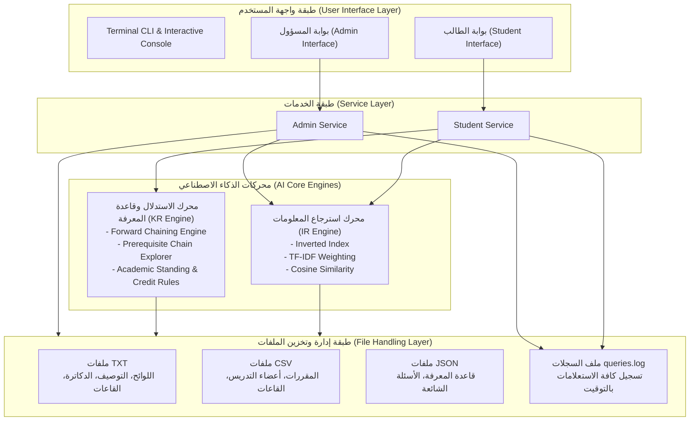

# 🎓 تقرير التاسك الأول: دليل الطالب الأكاديمي الذكي (Task 1: Smart Student Guide)
## مقرر الذكاء الاصطناعي — كلية الذكاء الاصطناعي – جامعة كفر الشيخ
### التقرير الفني الشامل لتصميم النظام ونتائج التشغيل (System Design & Verification Report)

---

## 1. الملخص التنفيذي (Executive Summary)

يهدف هذا المشروع (التاسك الأول: Smart Student Guide) إلى تصميم وتطوير نظام ذكي متكامل بلغة بايثون (Python) لمساعدة طلاب وأعضاء هيئة التدريس والإداريين في كلية الذكاء الاصطناعي بجامعة كفر الشيخ على الوصول الفوري والدقيق للمعلومات الأكاديمية (مثل اللوائح، توصيف المقررات، المتطلبات السابقة، أعضاء هيئة التدريس، والقاعات والمعامل)، وتقديم استشارات أكاديمية ذكية تجيب على الأسئلة الجوهرية للطالب مثل:
> **"ما هي المقررات الدراسية التي يحق لي تسجيلها في الفصل القادم وفقاً لحالتي الأكاديمية؟"**  
> *(Which courses am I eligible to register for?)*

تم بناء النظام بالكامل بالاعتماد على اللائحة الأكاديمية الرسمية المعتمدة لكلية الذكاء الاصطناعي بنظام الساعات المعتمدة (برنامج الذكاء الاصطناعي 2023).

---

## 2. معمارية النظام ومكوناته (System Architecture)

ينقسم النظام إلى أربعة محاور برمجية رئيسية مترابطة وفق النموذج التالي:



---

## 3. محرك استرجاع المعلومات (Information Retrieval Engine)

### 3.1 المعالجة المسبقة للنصوص (Text Preprocessing)
تم بناء معالج نصوص مخصص يدعم اللغتين العربية والإنجليزية:
1. **توحيد الحروف وحذف التشكيل (Normalization):**
   - حذف علامات التشكيل والتنوين والتطويل.
   - توحيد الألف (`أ`، `إ`، `آ` $\rightarrow$ `ا`).
   - توحيد التاء المربوطة (`ة` $\rightarrow$ `ه`) والألف المقصورة (`ى` $\rightarrow$ `ي`).
2. **استبعاد كلمات التوقف (Stopword Filtering):**
   - قائمة شاملة لكلمات التوقف العربية (في، من، على، الذي، التي، هذا، هو...).
   - قائمة كلمات التوقف الإنجليزية (the, a, is, are, in, at, to...).
3. **الجذع الخفيف (Light Stemming):**
   - إزالة السوابق الشائعة (ال، كال، بال، وال، فال) واللواحق (ات، ون، ين، هم، ها، نا).

### 3.2 الفهرس المعكوس (Inverted Index)
يقوم الفهرس بربط كل مصطلح $t$ بقائمة الوثائق/المقاطع التي ورد فيها مع تكرار المصطلح:
$$\text{Index}[t] = \{ d_1: f_{t, d_1}, \; d_2: f_{t, d_2}, \dots \}$$

### 3.3 الأوزان الحسابية (TF-IDF Weighting)
* **تكرار المصطلح النسبي (Term Frequency):**
  $$TF(t, d) = \frac{f_{t, d}}{\sum_{t' \in d} f_{t', d}}$$
* **معكوس تكرار الوثيقة المنعم (Smooth Inverse Document Frequency):**
  $$IDF(t) = \ln\left( \frac{N + 1}{DF(t) + 1} \right) + 1$$
* **وزن المصطلح:**
  $$w(t, d) = TF(t, d) \times IDF(t)$$

### 3.4 التشابه الجيبي والترتيب (Cosine Similarity Ranking)
لحساب درجة التطابق بين استعلام الطالب $q$ والوثيقة $d$:
$$\text{CosineSim}(q, d) = \frac{\vec{w}_q \cdot \vec{w}_d}{\|\vec{w}_q\| \cdot \|\vec{w}_d\|} = \frac{\sum_{t \in q \cap d} w(t, q) \cdot w(t, d)}{\sqrt{\sum_{t \in q} w(t, q)^2} \cdot \sqrt{\sum_{t \in d} w(t, d)^2}}$$
يتم ترتيب الوثائق تنازلياً وفق درجة التشابه مع استخلاص مقتطف سياقي (Snippet) يبرز الكلمات المطابقة.

---

## 4. تمثيل المعرفة ومحرك الاستدلال (Knowledge Representation & Inference)

### 4.1 نمذجة القواعد والحقائق (Rules & Facts)
استناداً إلى مواد لائحة كلية الذكاء الاصطناعي بجامعة كفر الشيخ:

1. **قاعدة فحص المتطلب السابق (Prerequisite Constraint):**
   $$\forall p \in \text{Prerequisites}(C): \text{Passed}(p) \implies \text{Eligible}(C)$$
2. **قاعدة مشروع التخرج (Graduation Project - Article 14):**
   $$\text{PassedCreditHours} \ge 100 \implies \text{Eligible}(\text{GP411})$$
3. **قاعدة التدريب الميداني الصيفي (Summer Field Training - Article 19):**
   $$\text{PassedCreditHours} \ge 72 \implies \text{Eligible}(\text{FIELD\_TRAINING})$$
4. **قاعدة المستويات الأكاديمية (Academic Levels - Article 16):**
   - المستوى الأول: $\text{Hours} < 30$
   - المستوى الثاني: $30 \le \text{Hours} < 65$
   - المستوى الثالث: $65 \le \text{Hours} < 100$
   - المستوى الرابع: $\text{Hours} \ge 100$
5. **قاعدة الإنذار الأكاديمي والملاحظة (Academic Probation - Article 22):**
   $$\text{Semesters} > 1 \land \text{CGPA} < 2.00 \implies \text{AcademicProbation}(\text{Warning})$$
6. **قاعدة حدود ساعات التسجيل (Credit Hour Registration Limits - Article 8):**
   - مستجد بالفصل الأول: الحد الأقصى 18 ساعة.
   - $\text{CGPA} \ge 3.00$ أو فصل التخرج: الحد الأقصى 21 ساعة.
   - $2.00 \le \text{CGPA} < 3.00$: الحد الأقصى 18 ساعة.
   - $1.00 \le \text{CGPA} < 2.00$: الحد الأقصى 15 ساعة (مقيد لرفع المعدل).
   - $\text{CGPA} < 1.00$: الحد الأقصى 12 ساعة فقط.
   - الحد الأدنى للتسجيل 9 ساعات معتمدة.

### 4.2 محرك الاستدلال بالتعاقب الأمامي (Forward Chaining)
* يستقبل المحرك ملف الطالب: المقررات المجتازة بنجاح، المعدل التراكمي CGPA، وعدد الفصول.
* يقوم المحرك بمسح كامل شجرة المقررات الدراسية في اللائحة (62 مقرراً عبر المستويات الأربعة).
* يستنتج قائمة المقررات المؤهل لتسجيلها فوراً، والمقررات المغلقة مع ذكر المتطلبات المتبقية بدقة، وتوليد النصائح الأكاديمية وحد الساعات المسموح.
* تتبع المسار التراكمي للمتطلبات (Prerequisite Dependency Chain Tree) لمساعدة الطالب في التخطيط الأكاديمي.

---

## 5. إدارة وتخزين الملفات (File Handling & Logging)

1. **ملفات TXT (`data/documents/`):**
   - `regulations_general.txt`: الرؤية والرسالة والأقسام والدرجة ونظام الـ 144 ساعة.
   - `regulations_registration_and_gpa.txt`: مواعيد التسجيل، الحذف والإضافة، الغياب، حساب الـ CGPA، الإنذارات.
   - `regulations_graduation_and_training.txt`: مشروع التخرج، التدريب الصيفي، مرتبة الشرف، الرسوب والتحسين.
   - `course_descriptions.txt`: التوصيف الأكاديمي الشامل لكل المقررات.
   - `faculty_staff.txt`: بيانات العميد، الوكلاء، ورؤساء الأقسام، المكاتب والإيميلات والساعات المكتبية.
   - `campus_rooms_and_labs.txt`: دليل المدرجات والمعامل (معمل الروبوتات، معمل التعلم العميق، معمل الـ IoT).
2. **ملفات CSV (`data/`):**
   - `courses.csv`: جدول المقررات الكودي، الساعات المعتمدة، نوع المقرر، والقسم والمتطلب.
   - `staff.csv`: بيانات أعضاء هيئة التدريس والهيئة المعاونة.
   - `rooms.csv`: القاعات والمعامل والتجهيزات والسعة الاستيعابية.
3. **ملفات JSON (`data/`):**
   - `knowledge_base.json`: حقائق وقواعد اللائحة والمتطلبات السابقة وحدود الـ GPA.
   - `faqs.json`: بنك الأسئلة الشائعة وإجاباتها الرسمية.
   - `students.json`: سجل ملفات الطلاب وحالتهم الأكاديمية.
4. **ملف السجلات (`data/queries.log`):**
   - يسجل كل استعلام مع التاريخ والوقت، هوية المستخدم، نوع الاستعلام، والنتيجة المعادة بصيغة قياسية:
   ```log
   [2026-10-26 19:26:31] [USER: STUDENT] [TYPE: INFERENCE_ELIGIBILITY] Query: "Which courses am I eligible to register for?" | Outcome: Inferred 19 eligible courses | Level: Level 1 | Standing: Good Standing
   ```

---

## 6. واجهات الاستخدام (Interfaces)

1. **واجهة الطالب (Student Interface):**
   - تحديث وإدخال الملف الشخصي (المقررات المجتازة، الـ CGPA، الفصول المكتملة).
   - البحث في اللوائح والمقررات والقاعات بهندسة استرجاع المعلومات.
   - الاستعلام الذكي عن المقررات المتاحة للتسجيل.
   - الاستعلام عن مقرر محدد: "هل يمكنني تسجيل مقرر X؟".
   - استعراض شجرة متطلبات مقرر متقدم.
   - استعراض الأسئلة الشائعة (FAQs).
2. **واجهة المسؤول (Admin Interface):**
   - استعراض لوحة الإحصائيات الفورية للنظام.
   - إضافة وتعديل المقررات مع المزامنة الفورية في CSV وقاعدة المعرفة JSON.
   - إضافة وتحديث وثائق اللائحة النصية (مع إعادة بناء الفهرس المعكوس Inverted Index تلقائياً).
   - إضافة وتعديل الأسئلة الشائعة.
   - تتبع سجل عمليات واستعلامات الطلاب من `queries.log`.

---

## 7. نتائج التشغيل الفعلي (Sample Runs & Verification Results)

تم تشغيل حزمة الاختبارات الشاملة عبر `sample_runs.py` وسجل النظام النتائج الحقيقية التالية:

### تجربة 1: استرجاع المعلومات (IR Search Matches)
```
🔍 Query: 'مشروع التخرج وساعات تسجيله'
   [1] Document: مادة (14): مشروع التخرج (Graduation Project - GP411)
       Score (Cosine Sim): 0.7056
       Source File: regulations_graduation_and_training.txt
       Snippet: مادة (14): مشروع التخرج (Graduation Project - GP411) - يحق للطالب تسجيل مقرر مشروع التخرج بشرط أن يكون قد اجتاز بنجاح 100 ساعة معتمدة...

🔍 Query: 'الإنذار الأكاديمي والملاحظة وفصل الطالب'
   [1] Document: مادة (22): الإنذار الأكاديمي والملاحظة الأكاديمية (Academic Probation)
       Score (Cosine Sim): 0.5154
       Source File: regulations_registration_and_gpa.txt
       Snippet: مادة (22): الإنذار الأكاديمي والملاحظة الأكاديمية - يوضع الطالب تحت الملاحظة الأكاديمية ويوجه له إنذار أكاديمي...

🔍 Query: 'Deep Learning neural networks'
   [1] Document: [ML311] Fundamentals of Deep Learning (أساسيات التعلم العميق)
       Score (Cosine Sim): 0.6830
       Source File: course_descriptions.txt
       Snippet: [ML311] Fundamentals of Deep Learning Prerequisite: ML211 (Introduction to Machine Learning) Credit Hours: 3...
```

### تجربة 2: محرك الاستدلال لحالات طلابية مختلفة (Student Scenarios)

#### الحالة الأولى: طالب متفوق أنهى المستوى الأول (CGPA = 3.40)
* **المستوى المستنتج:** Level 1 (Freshman) - ساعات مجتازة: 18 ساعة.
* **الحالة الأكاديمية:** Good Standing.
* **الحد المسموح به للتسجيل:** من 9 إلى 21 ساعة معتمدة (معدل $\ge 3.00$).
* **المقررات المتاحة للتسجيل:** 19 مقرراً استوفت شروطها، من ضمنها:
  - `[BC121]` البرمجة بلغة بايثون (استوفت متطلب البرمجة الهيكلية `BC111`).
  - `[ML121]` مفاهيم في الذكاء الاصطناعي (استوفت متطلب أساسيات الحاسب `MA112`).
  - `[BC122]` التصميم المنطقي (استوفت متطلب الدوائر الكهربية `MA114`).
* **فحص مقرر مشروع التخرج GP411:**
  > ❌ **غير مؤهل:** لا يمكنك تسجيل المقرر لعدم استيفاء المتطلبات السابقة: اجتياز 100 ساعة معتمدة بنجاح (المجتاز حالياً: 18 ساعة).

#### الحالة الثانية: طالب متعثر وتحت الملاحظة (CGPA = 1.70)
* **المستوى المستنتج:** Level 1 - ساعات مجتازة: 7 ساعات.
* **الحالة الأكاديمية:** Academic Probation (تحت الملاحظة الأكاديمية - إنذار أكاديمي).
* **التنبيه الصادر:** *"تنبيه: معدلك التراكمي أقل من 2.00، أنت تحت الملاحظة الأكاديمية وفقاً للمادة (22) من اللائحة"*.
* **الحد المسموح به للتسجيل:** مقيد بـ **15 ساعة معتمدة فقط** لمساعدته على التركيز وتحسين المعدل التراكمي.

#### الحالة الثالثة: طالب بالمستوى الرابع مؤهل لمشروع التخرج (Senior, 102 ساعة)
* **المستوى المستنتج:** Level 4 (Senior) - ساعات مجتازة: 102 ساعة معتمدة.
* **فحص مقرر مشروع التخرج GP411:**
  > ✅ **مؤهل للتسجيل:** نعم! أنت مؤهل لتسجيل مقرر GP411 (مشروع التخرج أ). جميع المتطلبات السابقة مكتملة (اجتياز أكثر من 100 ساعة معتمدة).

### تجربة 3: شجرة تتبع المتطلبات السابقة لمقرر متقدم (Prerequisite Lineage)
المقرر المستهدف: `[ML411]` تصميم الأنظمة للذكاء الاصطناعي (System Design for AI):
```text
└── [BC111] البرمجة الهيكلية (Structured Programming)
    └── [BC211] البرمجة الشيئية (Object Oriented Programming)
        └── [BC223] مقدمة في هياكل البيانات (Introduction to Data Structures)
            └── [BC312] مقدمة في الخوارزميات (Introduction to Algorithms)
                └── يفتح المقرر النهائي [ML411]!
```

### تجربة 4: عمليات المسؤول والتسجيل في queries.log
* تم إضافة مقرر `[AI499]` (سيمنار الذكاء الاصطناعي المتقدم) بنجاح إلى ملف CSV مع تحديث المتطلب في `knowledge_base.json`.
* تم إضافة سؤال شائع جديد برقم `faq_11`.
* تسجيل كافة العمليات مع طابع زمني دقيق في ملف `queries.log`.

---

## 8. دليل تشغيل النظام (How to Run)

1. **التشغيل التفاعلي (Interactive Console App):**
   ```powershell
   python main.py
   ```
2. **تشغيل حزمة الاختبارات والعروض التجريبية التلقائية:**
   ```powershell
   python main.py --demo
   ```
3. **البحث المباشر في اللائحة والمقررات (Direct IR Search):**
   ```powershell
   python main.py --search "مشروع التخرج"
   ```
4. **فحص أهلية مقرر دراسي مباشر:**
   ```powershell
   python main.py --check "ML211"
   ```

---
**إعداد وتطوير:** مشروع دليل الطالب الأكاديمي الذكي – 2026.
